Universes from <a href="https://github.com/Nam0101/claude-multiverse">claude-multiverse</a>, my Claude Code theme mod with 114 of them. Same chair in every one.

## 🧑‍💻 About me

## 🚀 Featured projects

<a href="https://github.com/Nam0101/android-mcp-toolkit"><picture><source media="(prefers-color-scheme: dark)" srcset="https://github-readme-stats.vercel.app/api/pin/?username=Nam0101&repo=android-mcp-toolkit&description_lines_count=2&bg_color=0d1117&border_color=30363d&title_color=f72585&icon_color=b5179e&text_color=c9d1d9"></picture></a>
<a href="https://github.com/Nam0101/rexc"><picture><source media="(prefers-color-scheme: dark)" srcset="https://github-readme-stats.vercel.app/api/pin/?username=Nam0101&repo=rexc&description_lines_count=2&bg_color=0d1117&border_color=30363d&title_color=f72585&icon_color=b5179e&text_color=c9d1d9"></picture></a>
<a href="https://github.com/Nam0101/reflex-android"><picture><source media="(prefers-color-scheme: dark)" srcset="https://github-readme-stats.vercel.app/api/pin/?username=Nam0101&repo=reflex-android&description_lines_count=2&bg_color=0d1117&border_color=30363d&title_color=f72585&icon_color=b5179e&text_color=c9d1d9"></picture></a>
<a href="https://github.com/Nam0101/mirako"><picture><source media="(prefers-color-scheme: dark)" srcset="https://github-readme-stats.vercel.app/api/pin/?username=Nam0101&repo=mirako&description_lines_count=2&bg_color=0d1117&border_color=30363d&title_color=f72585&icon_color=b5179e&text_color=c9d1d9"></picture></a>

Also: <a href="https://github.com/Nam0101/claude-multiverse">claude-multiverse</a>, a Claude Code theme mod with 114 dark universes.

## 🏆 Where I rank

<a href="https://gitranks.com/profile/Nam0101"><picture><source media="(prefers-color-scheme: dark)" srcset="https://gitranks.com/badge/user/Nam0101/profile-card.svg?theme=dark"></picture></a>

<a href="https://gitranks.com/profile/Nam0101"><picture><source media="(prefers-color-scheme: dark)" srcset="https://gitranks.com/badge/user/Nam0101/tier.svg?theme=dark"></picture></a>
<a href="https://gitranks.com/profile/Nam0101"><picture><source media="(prefers-color-scheme: dark)" srcset="https://gitranks.com/badge/user/Nam0101/rank.svg?theme=dark"></picture></a>
<a href="https://gitranks.com/profile/Nam0101"><picture><source media="(prefers-color-scheme: dark)" srcset="https://gitranks.com/badge/user/Nam0101/language-rank.svg?theme=dark"></picture></a>
<a href="https://gitranks.com/profile/Nam0101"><picture><source media="(prefers-color-scheme: dark)" srcset="https://gitranks.com/badge/user/Nam0101/month.svg?theme=dark"></picture></a>

## 📈 GitHub activity

<picture><source media="(prefers-color-scheme: dark)" srcset="https://github-readme-stats.vercel.app/api?username=Nam0101&show_icons=true&count_private=true&card_width=495&bg_color=0d1117&border_color=30363d&title_color=f72585&icon_color=b5179e&text_color=c9d1d9&ring_color=f72585"></picture>
<picture><source media="(prefers-color-scheme: dark)" srcset="https://github-readme-streak-stats.herokuapp.com/?user=Nam0101&background=0d1117&border=30363d&stroke=30363d&ring=f72585&fire=f72585&currStreakNum=ffffff&sideNums=ffffff&currStreakLabel=f72585&sideLabels=c9d1d9&dates=8b949e"></picture>

<picture><source media="(prefers-color-scheme: dark)" srcset="https://github-readme-activity-graph.vercel.app/graph?username=Nam0101&bg_color=0d1117&color=c9d1d9&title_color=f72585&line=f72585&point=4cc9f0&area=true&area_color=7209b7&hide_border=true&radius=8"></picture>

<picture><source media="(prefers-color-scheme: dark)" srcset="https://raw.githubusercontent.com/Nam0101/Nam0101/output/snake-dark.svg"></picture>

## 🛠️ Toolbox

 

